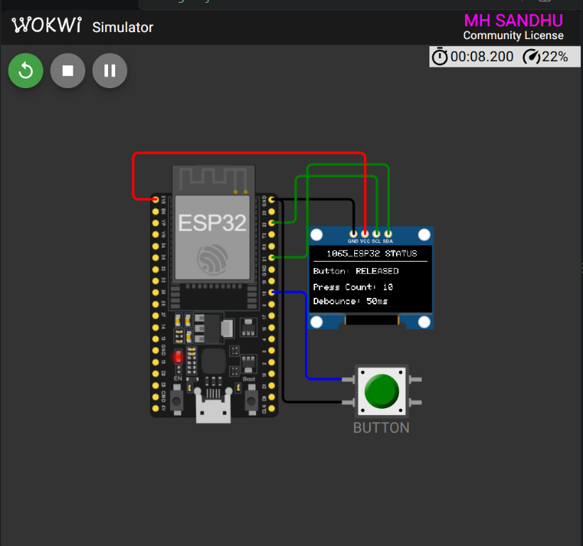

<div align="center">

# ESP32 OLED Button Debounce

### Homework 1 — Press Counter and Status Display

<p>
  
  
  
  
</p>

<p>
  <strong>Registration:</strong> 24-NTU-CS-FL-1065
  &nbsp;&nbsp;|&nbsp;&nbsp;
  <strong>Platform:</strong> ESP32
</p>

</div>

---

## Project Overview

This homework project combines an ESP32, an SSD1306 OLED and a push button to create a reliable button status display. The firmware filters short electrical transitions with a **50 ms software debounce interval**, counts accepted button presses and updates the OLED only when the displayed state changes.

### What it demonstrates

- Button input handling with `INPUT_PULLUP`
- Software debounce using `millis()`
- Press counting on stable button transitions
- SSD1306 OLED status rendering
- Event-driven display refresh

---

## Wokwi Simulation

<div align="center">



<br>
<sub>ESP32 OLED button debounce project running in Wokwi.</sub>

</div>

---

## Circuit Diagram

```text
              OLED BUTTON DEBOUNCE CIRCUIT

     ESP32 DevKit                    SSD1306 OLED
     ┌──────────────┐              ┌──────────────┐
     │ GPIO 21 ─────┼──────────────┤ SDA          │
     │ GPIO 22 ─────┼──────────────┤ SCL          │
     │ 3V3 ─────────┼──────────────┤ VCC          │
     │ GND ─────────┼──────────────┤ GND          │
     │              │              └──────────────┘
     │ GPIO 18 ─────┼──── Button
     │ GND ─────────┼──── Button return
     └──────────────┘
```

## Pin Connections

| ESP32 pin | Component pin | Function |
|:---------:|:-------------:|---------|
| `GPIO 21` | OLED `SDA` | I2C data |
| `GPIO 22` | OLED `SCL` | I2C clock |
| `3V3` | OLED `VCC` | OLED power |
| `GND` | OLED `GND` | Common ground |
| `GPIO 18` | Button signal | Button input |
| `GND` | Button return | Active-low button path |

| Setting | Value |
|---------|-------|
| OLED controller | SSD1306 |
| OLED resolution | 128 × 64 |
| I2C address | `0x3C` |
| Debounce interval | `50 ms` |
| Button mode | `INPUT_PULLUP` |

---

## How It Works

1. The button is configured with the ESP32 internal pull-up.
2. Every raw input change restarts the debounce timer.
3. The new state is accepted only after remaining stable for `50 ms`.
4. A stable `LOW` transition increments `pressCount`.
5. The OLED shows the button state and accepted press count.
6. The display refreshes only when the screen content changes.

```text
Raw input changes
        │
        ▼
Restart 50 ms timer
        │
        ▼
Input stable for 50 ms?
        │
   Yes  ▼
Accept state and update OLED
        │
        ▼
Count only the PRESSED transition
```

---

## OLED Output

The display shows:

```text
1065_ESP32 STATUS
-----------------
Button: RELEASED
Press Count: 0
Debounce: 50ms
```

When the button is pressed and accepted:

```text
Button: PRESSED
Press Count: 1
```

---

## Project Files

- [`src/main.cpp`](src/main.cpp) — OLED and debounce firmware
- [`diagram.json`](diagram.json) — Wokwi circuit definition
- [`platformio.ini`](platformio.ini) — PlatformIO environment and libraries
- [`wokwi.toml`](wokwi.toml) — Wokwi firmware and ELF paths

---

<div align="center">

**Embedded IoT System · Homework 1**

Built with ESP32, PlatformIO and Wokwi.

</div>
