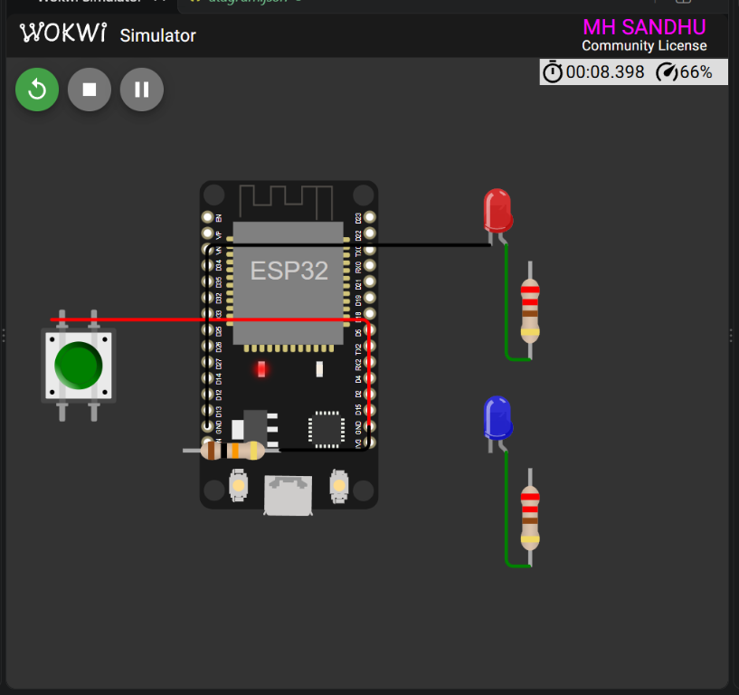

<div align="center">

# ESP32 Button Controlled Dual LED

### Week 2 — Digital Input and Dual Output Control

<p>
  
  
  
  
</p>

<p>
  <strong>Registration:</strong> 24-NTU-CS-FL-1065
  &nbsp;&nbsp;|&nbsp;&nbsp;
  <strong>Platform:</strong> ESP32
</p>

</div>

---

## Project Overview

This Week 2 project demonstrates how one push button can control two LEDs in opposite states. The button is connected to GPIO 36, while the red and blue LEDs are controlled from GPIO 2 and GPIO 5.

When the button is released, the red LED is on and the blue LED is off. When the button is pressed, the red LED turns off and the blue LED turns on.

### What it demonstrates

- Digital input reading with `digitalRead()`
- Active-high push-button logic
- Two independent GPIO outputs
- Opposite-state LED control
- External pull-down resistor for GPIO 36

---

## Wokwi Simulation

<div align="center">



<br>
<sub>ESP32 button-controlled dual LED circuit running in Wokwi.</sub>

</div>

---

## Circuit Diagram

```text
                    BUTTON INPUT

       3V3
        │
     Push Button
        │
        ├────────────── GPIO 36
        │
      10k ohm
        │
       GND

                   LED OUTPUTS

     GPIO 2 ───[ 220 ohm ]─── Red LED ─── GND

     GPIO 5 ───[ 220 ohm ]─── Blue LED ── GND
```

## Pin Connections

| ESP32 pin | Component | Function |
|:---------:|-----------|----------|
| `GPIO 36` | Push button signal | Digital input |
| `GPIO 36` | 10k ohm pull-down | Keeps input LOW when released |
| `3V3` | Push button supply | Provides HIGH when pressed |
| `GPIO 2` | Red LED through 220 ohm | Red LED output |
| `GPIO 5` | Blue LED through 220 ohm | Blue LED output |
| `GND` | LED cathodes and resistor return | Common ground |

| Component | Value |
|-----------|-------|
| Red LED resistor | `220 ohm` |
| Blue LED resistor | `220 ohm` |
| Button pull-down resistor | `10k ohm` |
| Button logic | Active HIGH |

---

## How It Works

The firmware continuously reads GPIO 36:

```cpp
const int buttonState = digitalRead(BUTTON_PIN);
```

### Button released

The pull-down resistor holds GPIO 36 LOW:

```text
Red LED  : ON
Blue LED : OFF
```

### Button pressed

The button connects GPIO 36 to 3V3, producing HIGH:

```text
Red LED  : OFF
Blue LED : ON
```

The two outputs are always opposite, so both LEDs are never active at the same time.

---

## Expected Behavior

| Button state | GPIO 36 | Red LED | Blue LED |
|--------------|:-------:|:-------:|:--------:|
| Released | `LOW` | ON | OFF |
| Pressed | `HIGH` | OFF | ON |

---

## Project Files

- [`src/main.cpp`](src/main.cpp) — button and dual LED firmware
- [`diagram.json`](diagram.json) — Wokwi circuit definition
- [`platformio.ini`](platformio.ini) — PlatformIO build configuration
- [`wokwi.toml`](wokwi.toml) — Wokwi firmware and ELF paths

---

<div align="center">

**Embedded IoT System · Week 2**

Built with ESP32, PlatformIO and Wokwi.

</div>
