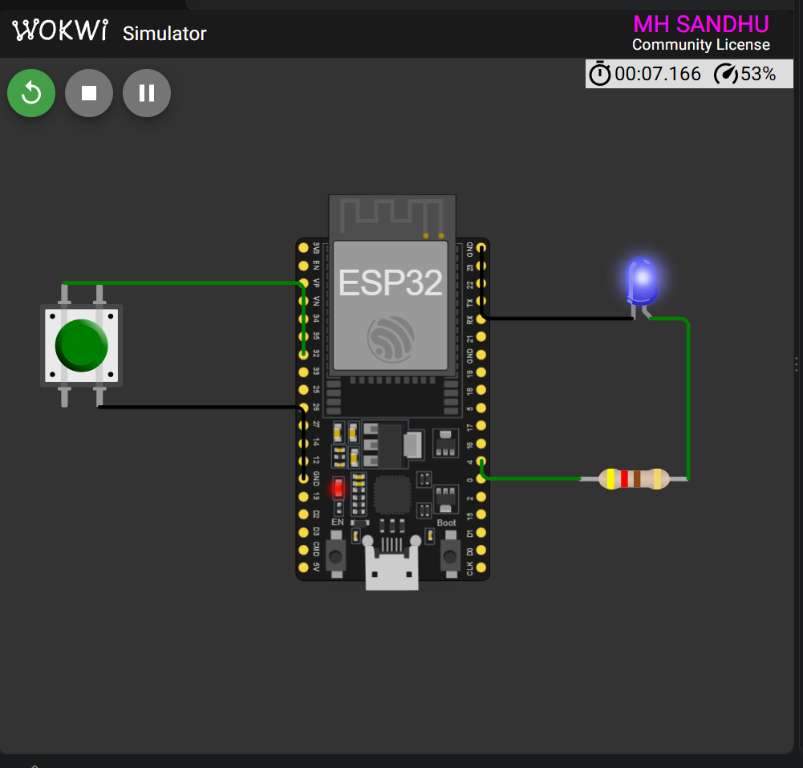

<div align="center">

# ESP32 Timer-Based Button Debounce

### Week 4 — Interrupt Debounce and LED Control

<p>
  
  
  
  
</p>

<p>
  <strong>Registration in source:</strong> 24-NTU-CS-FL-1056
  &nbsp;&nbsp;|&nbsp;&nbsp;
  <strong>Platform:</strong> ESP32
</p>

</div>

---

## Project Overview

This project demonstrates reliable button handling with an ESP32 external interrupt and a dedicated hardware debounce timer. A button press on GPIO 32 toggles the blue LED on GPIO 4, while a 50 ms timer prevents repeated triggers caused by mechanical button bounce.

The project also uses a repeating one-second hardware timer to toggle the LED automatically.

### What it demonstrates

- External GPIO interrupt handling
- Hardware timer-based debounce
- Repeating timer alarm configuration
- Falling-edge button detection
- ISR-controlled LED output
- Non-blocking operation without `delay()`

---

## Wokwi Simulation

<div align="center">



<br>
<sub>ESP32 button debounce and timer interrupt circuit running in Wokwi.</sub>

</div>

---

## Circuit Diagram

```text
              TIMER-BASED DEBOUNCE CIRCUIT

     ESP32 DevKit                         Blue LED
     ┌──────────────┐                  ┌──────────┐
     │              │                  │          │
     │ GPIO 32 ─────┼──── Push Button  │          │
     │              │                  │          │
     │ GPIO 4 ──────┼───[ 420 ohm ]────┤ Anode    │
     │              │                  │          │
     │ GND ─────────┼──────────────────┤ Cathode  │
     │              │                  │          │
     └──────────────┘                  └──────────┘
```

## Pin Connections

| ESP32 pin | Component pin | Function |
|:---------:|:-------------:|---------|
| `GPIO 32` | Push-button signal | External interrupt input |
| `GPIO 4` | Resistor and LED anode | LED output |
| `GND` | Button return | Active-low button path |
| `GND` | LED cathode | Common ground |

| Component or setting | Value |
|----------------------|-------|
| Button mode | `INPUT_PULLUP` |
| Interrupt edge | `FALLING` |
| Debounce period | `50 ms` |
| LED resistor | `420 ohm` |
| LED color | Blue |

---

## Timer Configuration

The ESP32 timer clock is configured with an 80-divider prescaler:

```text
ESP32 clock       = 80 MHz
Prescaler         = 80
Timer frequency   = 1 MHz
Timer tick        = 1 microsecond
Debounce timeout  = 50,000 microseconds
```

Two timer interrupts are used:

| Timer | Purpose | Period |
|-------|---------|--------:|
| Timer 0 | Automatic LED toggle | 1 second |
| Timer 1 | Release debounce lock | 50 ms |

---

## How Debouncing Works

1. A falling edge on GPIO 32 invokes `onButtonISR()`.
2. If the debounce lock is free, the lock is enabled.
3. The LED state is toggled once.
4. Timer 1 starts a one-shot 50 ms timeout.
5. Additional button edges during the timeout are ignored.
6. `onDebounceTimer()` clears the lock.
7. The next valid button press can then be accepted.

```text
Button edge
    │
    ▼
Debounce lock free?
    │
    ├── No  ── Ignore bounce
    │
    └── Yes
          │
          ▼
     Toggle LED
          │
          ▼
   Lock for 50 ms
          │
          ▼
     Accept next press
```

---

## Expected Behavior

```text
Timer 0: LED toggles automatically every 1 second
Button : A valid press toggles the LED immediately
Bounce : Repeated edges within 50 ms are ignored
```

The main `loop()` is intentionally empty because all timing and button handling are performed by hardware timer interrupts and the GPIO ISR.

---

## Project Files

- [`src/main.cpp`](src/main.cpp) — timer and debounce firmware
- [`diagram.json`](diagram.json) — Wokwi circuit definition
- [`platformio.ini`](platformio.ini) — PlatformIO build configuration
- [`wokwi.toml`](wokwi.toml) — Wokwi firmware and ELF paths

---

<div align="center">

**Embedded IoT System · Week 4**

Built with ESP32, PlatformIO and Wokwi.

</div>
