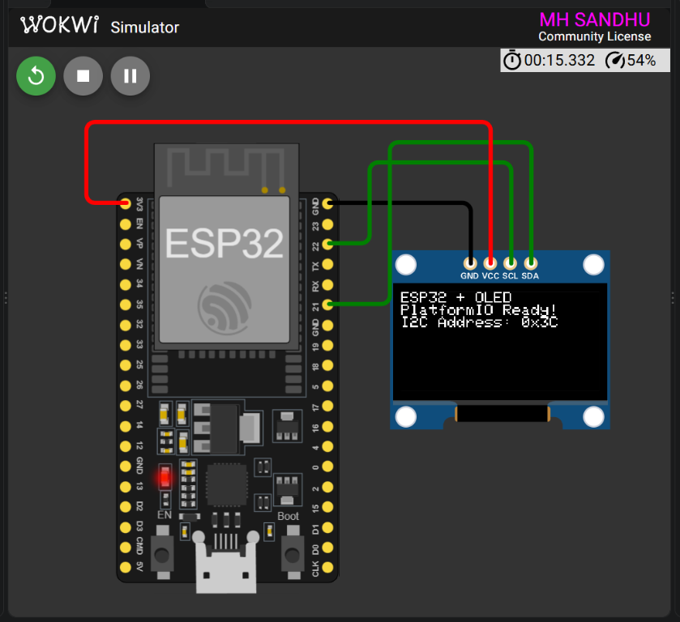

<div align="center">

# ESP32 OLED Display

### A clean I2C OLED demonstration for ESP32

<p>
  
  
  
  
</p>

<p>
  <strong>Registration:</strong> 24-NTU-CS-FL-1065
  &nbsp;&nbsp;|&nbsp;&nbsp;
  <strong>Platform:</strong> ESP32
</p>

</div>

---

## Project Overview

This project initializes a **128 x 64 SSD1306 OLED display** over the ESP32 I2C bus and renders a clear startup status screen. It is designed as a simple, reliable starting point for Embedded IoT display projects and can be tested directly in Wokwi or on physical ESP32 hardware.

### What it demonstrates

- SSD1306 OLED initialization at I2C address `0x3C`
- ESP32 custom I2C pin configuration
- Text rendering with the Adafruit GFX and SSD1306 libraries
- Serial Monitor initialization diagnostics
- PlatformIO and Wokwi project configuration

---

## Wokwi Simulation

The verified simulation displays the following screen:

<div align="center">



<br>
<sub>ESP32 and SSD1306 OLED running in Wokwi.</sub>

</div>

---

## Circuit Diagram

```text
                    I2C BUS

     ESP32 DevKit C-V4                 SSD1306 OLED
     ┌────────────────┐              ┌──────────────┐
     │                │              │              │
     │  3V3 ──────────┼──────────────┤ VCC          │
     │  GND ──────────┼──────────────┤ GND          │
     │  GPIO 22 ──────┼──────────────┤ SCL          │
     │  GPIO 21 ──────┼──────────────┤ SDA          │
     │                │              │              │
     └────────────────┘              └──────────────┘
```

## Pin Connections

| ESP32 pin | OLED pin | Function |
|:---------:|:--------:|---------|
| `3V3` | `VCC` | OLED power |
| `GND` | `GND` | Common ground |
| `GPIO 21` | `SDA` | I2C data |
| `GPIO 22` | `SCL` | I2C clock |

| Setting | Value |
|---------|-------|
| Display controller | SSD1306 |
| Display size | 128 × 64 |
| Interface | I2C |
| I2C address | `0x3C` |
| OLED reset | Not used (`-1`) |

---

## Display Output

When the firmware starts, the OLED shows:

```text
ESP32 + OLED
PlatformIO Ready!
I2C Address: 0x3C
```

The Serial Monitor prints:

```text
OLED initialized successfully.
```
