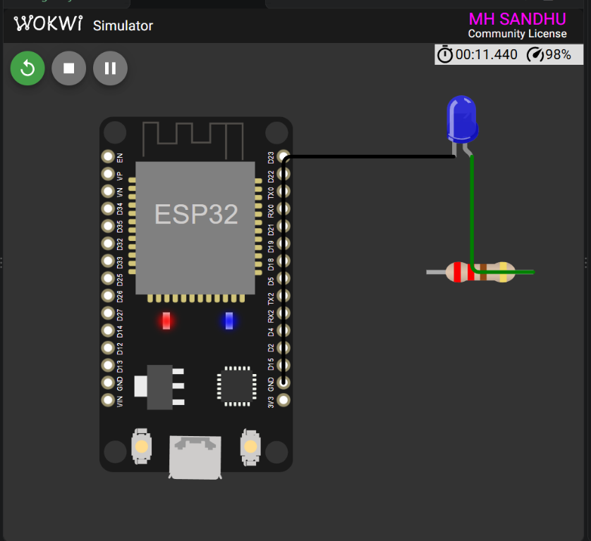

<div align="center">

# ESP32 LED Blink

### Task 1 — Digital Output Control

<p>
  
  
  
</p>

<p>
  <strong>Registration:</strong> 24-NTU-CS-FL-1065
  &nbsp;&nbsp;|&nbsp;&nbsp;
  <strong>Platform:</strong> ESP32
</p>

</div>

---

## Project Overview

This project demonstrates basic digital output control on an ESP32. A blue LED connected to GPIO 2 turns on and off at one-second intervals, creating a continuous blink pattern.

### What it demonstrates

- GPIO output configuration
- LED control with `digitalWrite()`
- Timing with a one-second interval
- Serial Monitor status messages
- PlatformIO and Wokwi workflow

---

## Wokwi Simulation

<div align="center">



<br>
<sub>ESP32 LED blink circuit running in Wokwi.</sub>

</div>

---

## Circuit Diagram

```text
                 LED OUTPUT CIRCUIT

     ESP32 DevKit                         Blue LED
     ┌──────────────┐                  ┌──────────┐
     │              │                  │          │
     │ GPIO 2 ──────┼───[ 220 ohm ]────┤ Anode    │
     │              │                  │          │
     │ GND ─────────┼──────────────────┤ Cathode  │
     │              │                  │          │
     └──────────────┘                  └──────────┘
```

## Pin Connections

| ESP32 pin | Component pin | Function |
|:---------:|:-------------:|---------|
| `GPIO 2` | Resistor input | LED control output |
| `GND` | LED cathode | Common ground |

| Component | Value |
|-----------|-------|
| LED | Blue |
| Series resistor | `220 ohm` |
| Blink interval | `1000 ms` |

---

## Output Behavior

The LED follows this repeating sequence:

```text
LED: ON
Wait 1 second
LED: OFF
Wait 1 second
```

The Serial Monitor starts with:

```text
IOT TASK 1 - ESP32 LED BLINK
Registration: 24-NTU-CS-FL-1065
```

---

## Files

- [`src/main.cpp`](src/main.cpp) — ESP32 LED blink firmware
- [`diagram.json`](diagram.json) — Wokwi circuit definition
- [`platformio.ini`](platformio.ini) — PlatformIO build configuration
- [`wokwi.toml`](wokwi.toml) — Wokwi firmware and ELF paths

---

<div align="center">

**Embedded IoT System · Fall 2026**

Built with ESP32, PlatformIO and Wokwi.

</div>
