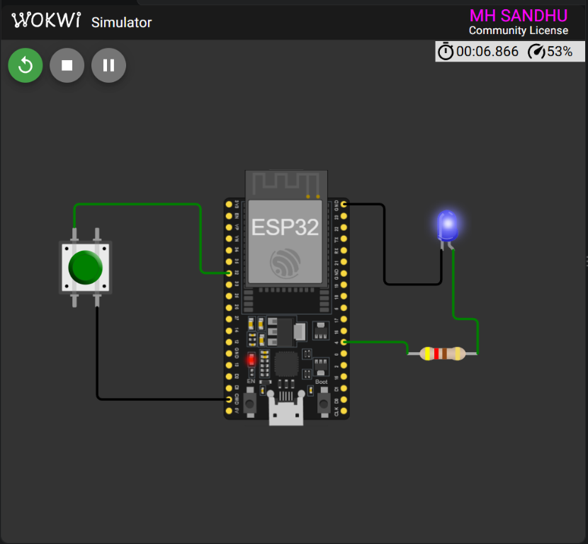

<div align="center">

# ESP32 External Interrupt

### Week 3 — Button Interrupt and LED Toggle

<p>
  
  
  
  
</p>

<p>
  <strong>Registration:</strong> 1234
  &nbsp;&nbsp;|&nbsp;&nbsp;
  <strong>Platform:</strong> ESP32
</p>

</div>

---

## Project Overview

This project demonstrates an **external GPIO interrupt** on the ESP32. A button press on GPIO 32 triggers an interrupt service routine (ISR), which immediately toggles the state of a blue LED connected to GPIO 4.

The main loop remains free for other application tasks because the button event is handled asynchronously by the interrupt system.

### What it demonstrates

- External GPIO interrupt handling
- Falling-edge button detection
- ISR-based LED state toggling
- `IRAM_ATTR` interrupt handler placement
- Pull-up input configuration

---

## Wokwi Simulation

<div align="center">



<br>
<sub>ESP32 external interrupt circuit running in Wokwi.</sub>

</div>

---

## Circuit Diagram

```text
              EXTERNAL INTERRUPT CIRCUIT

     ESP32 DevKit                         Blue LED
     ┌──────────────┐                  ┌──────────┐
     │              │                  │          │
     │ GPIO 32 ─────┼──── Push Button  │          │
     │              │                  │          │
     │ GPIO 4 ──────┼───[ 420 ohm ]────┤ Anode    │
     │              │                  │          │
     │ GND ─────────┼──────────────────┤ Cathode  │
     │              │                  │          │
     └──────────────┘                  └──────────┘
```

## Pin Connections

| ESP32 pin | Component pin | Function |
|:---------:|:-------------:|---------|
| `GPIO 32` | Push-button signal | External interrupt input |
| `GPIO 4` | Resistor and LED anode | LED output |
| `GND` | Push-button ground | Button return path |
| `GND` | LED cathode | LED return path |

| Setting | Value |
|---------|-------|
| Interrupt trigger | `FALLING` |
| Button mode | `INPUT_PULLUP` |
| LED resistor | `420 ohm` |
| LED color | Blue |

---

## How It Works

1. The button input is configured with the ESP32 internal pull-up.
2. Pressing the button pulls GPIO 32 from `HIGH` to `LOW`.
3. The `FALLING` edge invokes `handleButton()`.
4. The ISR reverses `ledState`.
5. The LED on GPIO 4 changes state immediately.

```cpp
attachInterrupt(
    digitalPinToInterrupt(buttonPin),
    handleButton,
    FALLING
);
```

The `loop()` function is intentionally empty because the button event is handled by the interrupt service routine.

---

## Expected Behavior

```text
Initial state  : LED OFF
Button pressed : LED ON
Button pressed : LED OFF
Button pressed : LED ON
```

Each valid falling-edge event toggles the LED once.

---

## Project Files

- [`src/main.cpp`](src/main.cpp) — external interrupt firmware
- [`diagram.json`](diagram.json) — Wokwi circuit definition
- [`platformio.ini`](platformio.ini) — PlatformIO build configuration
- [`wokwi.toml`](wokwi.toml) — Wokwi firmware and ELF paths

---

<div align="center">

**Embedded IoT System · Week 3**

Built with ESP32, PlatformIO and Wokwi.

</div>
