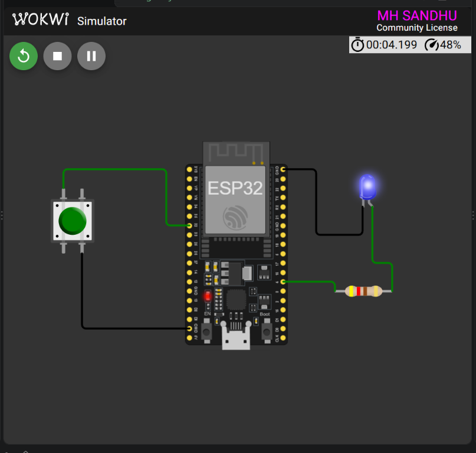

<div align="center">

# ESP32 Timer Interrupt

### Week 3 — Internal Hardware Timer

<p>
  
  
  
  
</p>

<p>
  <strong>Registration:</strong> 24-NTU-CS-FL-1065
  &nbsp;&nbsp;|&nbsp;&nbsp;
  <strong>Platform:</strong> ESP32
</p>

</div>

---

## Project Overview

This project demonstrates an ESP32 **internal hardware timer interrupt**. A timer alarm is configured to fire once every second, and its interrupt service routine toggles a blue LED connected to GPIO 4.

The LED timing is controlled by the hardware timer instead of delays in the main loop, leaving `loop()` available for other application work.

### What it demonstrates

- ESP32 hardware timer configuration
- Timer prescaler and microsecond tick calculation
- Repeating timer alarms
- ISR-based LED control
- Non-blocking timing without `delay()`

---

## Wokwi Simulation

<div align="center">



<br>
<sub>ESP32 timer interrupt circuit running in Wokwi.</sub>

</div>

---

## Circuit Diagram

```text
                 TIMER INTERRUPT OUTPUT

     ESP32 DevKit                         Blue LED
     ┌──────────────┐                  ┌──────────┐
     │              │                  │          │
     │ GPIO 4 ──────┼───[ 420 ohm ]────┤ Anode    │
     │              │                  │          │
     │ GND ─────────┼──────────────────┤ Cathode  │
     │              │                  │          │
     └──────────────┘                  └──────────┘
```

## Pin Connections

| ESP32 pin | Component pin | Function |
|:---------:|:-------------:|---------|
| `GPIO 4` | Resistor and LED anode | Timer-controlled LED output |
| `GND` | LED cathode | Common ground |

| Timer setting | Value |
|---------------|-------|
| Timer unit | Timer 0 |
| ESP32 clock | `80 MHz` |
| Prescaler | `80` |
| Timer frequency | `1 MHz` |
| Timer tick | `1 microsecond` |
| Alarm period | `1,000,000 microseconds` |
| Toggle interval | `1 second` |
| LED resistor | `420 ohm` |

---

## How It Works

1. Timer 0 starts with an `80` prescaler.
2. The 80 MHz ESP32 clock becomes a 1 MHz timer clock.
3. Each timer tick represents one microsecond.
4. The repeating alarm is set to `1,000,000` ticks.
5. `onTimer()` runs every second.
6. The ISR toggles the LED state.

```cpp
My_timer = timerBegin(0, 80, true);
timerAttachInterrupt(My_timer, &onTimer, true);
timerAlarmWrite(My_timer, 1000000, true);
timerAlarmEnable(My_timer);
```

The main `loop()` is intentionally empty because the LED is controlled by the hardware timer interrupt.

---

## Expected Behavior

```text
At startup : LED OFF
After 1 s  : LED ON
After 2 s  : LED OFF
After 3 s  : LED ON
```

The LED continues toggling at a one-second interval.

---

## Project Files

- [`src/main.cpp`](src/main.cpp) — timer interrupt firmware
- [`diagram.json`](diagram.json) — Wokwi circuit definition
- [`platformio.ini`](platformio.ini) — PlatformIO build configuration
- [`wokwi.toml`](wokwi.toml) — Wokwi firmware and ELF paths

---

<div align="center">

**Embedded IoT System · Week 3**

Built with ESP32, PlatformIO and Wokwi.

</div>
