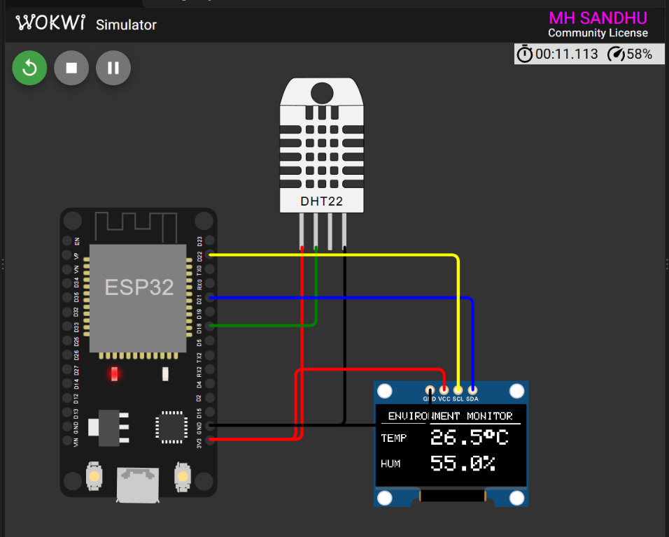

<div align="center">

# ESP32 DHT Sensor OLED Monitor

### Week 5 — Temperature and Humidity Display

<p>
  
  
  
  
</p>

<p>
  <strong>Registration:</strong> 24-NTU-1065
  &nbsp;&nbsp;|&nbsp;&nbsp;
  <strong>Platform:</strong> ESP32
</p>

</div>

---

## Project Overview

This Week 5 project reads temperature and humidity from a DHT sensor and displays the measurements on a 128 x 64 SSD1306 OLED. The firmware supports a real DHT11 sensor and automatically uses the DHT22 model when compiled for the Wokwi simulation.

Measurements are refreshed every two seconds and invalid or out-of-range readings are reported as sensor errors.

### What it demonstrates

- DHT11 and DHT22 sensor integration
- Temperature and humidity measurement
- SSD1306 OLED rendering over I2C
- Periodic non-blocking sensor reads
- Sensor value validation and error handling
- Wokwi-specific build configuration

---

## Wokwi Simulation

<div align="center">



<br>
<sub>ESP32 DHT22 and SSD1306 OLED environment monitor running in Wokwi.</sub>

</div>

---

## Circuit Diagram

```text
                 ENVIRONMENT MONITOR

     ESP32 DevKit              DHT Sensor
     ┌──────────────┐        ┌───────────┐
     │ 3V3 ─────────┼────────┤ VCC       │
     │ GPIO 18 ─────┼────────┤ DATA      │
     │ GND ─────────┼────────┤ GND       │
     │              │        └───────────┘
     │              │
     │ GPIO 21 ─────┼──────────── OLED SDA
     │ GPIO 22 ─────┼──────────── OLED SCL
     │ 3V3 ─────────┼──────────── OLED VCC
     │ GND ─────────┼──────────── OLED GND
     └──────────────┘
```

## Pin Connections

| ESP32 pin | Component pin | Function |
|:---------:|:-------------:|---------|
| `3V3` | DHT `VCC` | Sensor power |
| `GPIO 18` | DHT `DATA` | Temperature and humidity data |
| `GND` | DHT `GND` | Sensor ground |
| `GPIO 21` | OLED `SDA` | I2C data |
| `GPIO 22` | OLED `SCL` | I2C clock |
| `3V3` | OLED `VCC` | OLED power |
| `GND` | OLED `GND` | OLED ground |

| Setting | Value |
|---------|-------|
| OLED controller | SSD1306 |
| OLED resolution | 128 x 64 |
| OLED I2C address | `0x3C` |
| Real hardware sensor | DHT11 |
| Wokwi sensor model | DHT22 |
| Sensor read interval | 2 seconds |

---

## How It Works

1. The ESP32 initializes the I2C bus on GPIO 21 and GPIO 22.
2. The SSD1306 OLED is initialized at address `0x3C`.
3. The DHT sensor starts on GPIO 18.
4. A reading is taken every two seconds.
5. Temperature and humidity are validated.
6. Valid values are rendered on the OLED.
7. Invalid readings show a sensor error message and are logged to Serial Monitor.

The Wokwi build uses:

```cpp
#define DHT_TYPE DHT22
```

Physical hardware uses DHT11 by default:

```cpp
#define DHT_TYPE DHT11
```

---

## OLED Output

The display shows:

```text
ENVIRONMENT MONITOR
-------------------
TEMP       26.5°C
HUM        55.0%
```

The Serial Monitor reports sensor readings at `115200` baud.

---

## Project Files

- [`src/main.cpp`](src/main.cpp) — DHT sensor and OLED firmware
- [`diagram.json`](diagram.json) — Wokwi circuit definition
- [`platformio.ini`](platformio.ini) — PlatformIO environments and libraries
- [`wokwi.toml`](wokwi.toml) — Wokwi firmware and ELF paths

---

<div align="center">

**Embedded IoT System · Week 5**

Built with ESP32, DHT sensor, OLED, PlatformIO and Wokwi.

</div>
